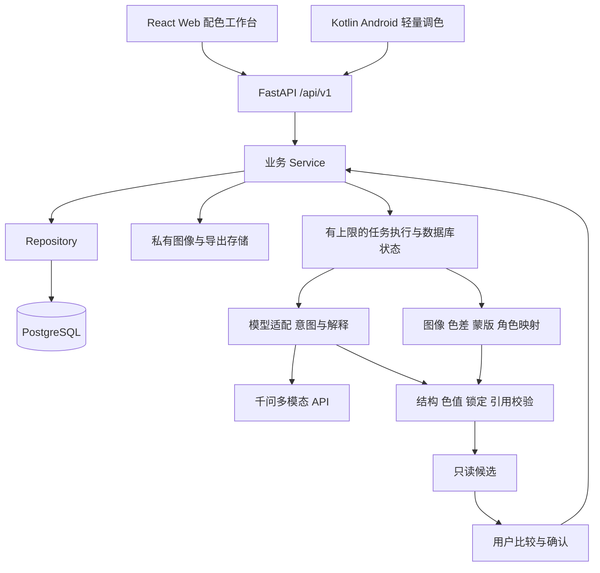

# PuppleTrouble 架构设计

## 总体原则

- 一套 FastAPI 后端、一套 PostgreSQL；React Web 与原生 Android 共享 API、模板和版本规则。
- 普通请求遵循 `API → Service → Repository → PostgreSQL`，API 不直接操作 ORM。
- 颜色分析遵循 `API → Service → algorithms`；AI 调整遵循 `API → Service → AI 适配／意图 → algorithms 约束校验 → 候选`。确认后才能写入项目版本。
- 颜色、蒙版、比例与锁定规则由确定性计算；模型承担语义、意图与解释，不猜色号，不直接写数据库。
- 模块化单体先满足四人三十天开发，不引入额外向量库、多服务或全能编辑器。

## 架构图

图示包含目标结构；当前仅运行检查、配置、数据库连接／初始迁移和两端启动首页已有实现。后续业务文件已预建为空，不能据图声称产品闭环已完成。

## 当前工程与后续模块

| 层 | 文件／目录 | 当前状态 |
|---|---|---|
| 后端入口 | `backend/app/main.py` | 已有应用工厂、统一错误、请求标识、CORS 和生命周期 |
| 配置／数据库 | `backend/app/core/config.py`、`database.py` | 根目录 .env 显式加载、私密字段、会话工厂；不在启动时自动建表 |
| 运行检查 | `backend/app/api/v1/endpoints/health.py` | 存活检查与数据库／迁移就绪检查 |
| API 聚合 | `backend/app/api/v1/router.py` | 只注册已实现的运行检查；业务空路由不导入 |
| 数据结构 | `backend/app/modules/auth/models.py`、`backend/alembic/versions/0001_initial_users.py` | users 结构与初始迁移；无内置账号，登录业务尚未实现 |
| 业务模块 | `backend/app/modules/*/` | auth、catalog、assets、projects、jobs、favorites、preferences、exports 的业务文件预留 |
| 算法／AI | `backend/app/algorithms/`、`ai/`、`knowledge/` | 仅预留，不调用真实模型或伪造结果 |
| Web | `frontend/src/App.tsx`、`shared/api/client.ts` | React 首页与真实健康请求，超时／断连有恢复入口；产品页面预留 |
| Android | `android/app/src/main/java/com/puppletrouble/app/` | Compose 首页、后台网络健康请求和重试；业务 Screen／ViewModel／Repository 预留 |

## 客户端边界

Web 为完整配色工作台，采用 React、TanStack Query 和共享 API 客户端；后续 Konva 渲染模板，Zustand 管草稿／撤销。Android 为颜色浏览、图片输入和少量模板的原生轻量调整，后续使用 ViewModel／StateFlow 与 Retrofit；当前运行检查使用系统 HTTP 客户端，不冒称完整业务网络层已完成。

两端共享 sRGB `#RRGGBB`、角色 background/text/primary/accent/supporting、图像归一化坐标及模板逻辑坐标。相同规范色值必须一致，字体排版单独验证。令牌首版仅在内存，客户端没有模型密钥；重启后重新登录。

## 数据与任务边界

ORM 只表达结构和数据库约束，Service 处理权限、状态、事务与版本；Repository 做访问，不绕过 Service 写数据。模型集中由 model_registry 导入供 Alembic 发现，迁移只改结构，种子导入另行实现。

首版任务受并发与超时限制，状态持久化，CPU 图像任务不阻塞 API；进程重启后将未完成任务标为失败，允许显式重试。当前任务服务仍为空，未实现持久调度。候选只生成角色颜色变更，校验锁定并集、base_version 和来源后交用户确认；确认保存用事务防止并发覆盖。

私人图像、蒙版和导出由带鉴权的接口读取，不能按裸 URL 当作授权。缓存含图像版本、算法版本、参数及访问范围；不因内容相同跨用户暴露资源。

## 运行检查与启动

`GET /api/v1/health` 不依赖数据库，返回统一 envelope；`GET /api/v1/health/ready` 连接真实数据库并检查迁移，未就绪返回 503，不返回连接串或秘密。当前不检查尚未实现的模型业务就绪状态。完整命令见[项目启动](项目启动.md)，配置由团队自行完成本机设置，不分配给 A/B/C/D 某个人。

接口见[接口文档](接口文档.md)，表结构见[数据库设计](数据库设计.md)，当前功能状态见[功能对应的模块](功能对应的模块.md)。
