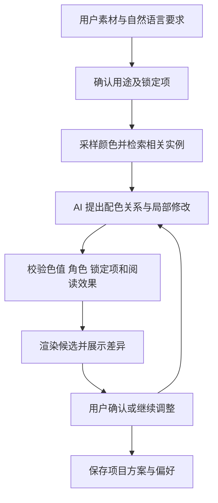

# PuppleTrouble 玩犊紫 项目文档

整理日期：2026 年 11 月 9 日
状态：产品与技术基线 v0.1，尚未完成原型验证。英文项目名 PuppleTrouble，中文名玩犊紫。本文配套项目开发计划、分工安排、接口文档、技术栈说明和环境配置说明。开发期为 2026 年 11 月 15 日至 12 月 14 日，共 30 个自然日、4 人。

## 1 项目定位

面向缺乏专业设计经验的大学生和普通办公用户，以颜色为入口，帮助用户发现颜色、看懂作品中的配色方式，并把喜欢的色彩关系应用到自己的作品中。

产品的核心价值是：用户不必先理解专业术语，也能通过实例、预览和自然语言作出有依据的配色选择，逐渐形成自己的审美判断。

产品主线为：**发现颜色 → 理解作品中的用法 → 应用到自己的页面 → 局部调整 → 保存和复用偏好**。

颜色承担主要功能与展示篇幅。字体、形状、排版和图表仅作为配色落地的辅助，不设置同等规模的独立创作系统。

建议主报“AI 赋能学习生产力”，围绕课程汇报、项目展示和学习成果创作。产品可以服务更广泛的办公场景，但参赛叙事应集中于大学生的真实创作任务。最终赛题归属应结合成品与大赛要求确认。

## 2 用户与问题

| 用户任务 | 主要困难 | 产品提供的帮助 |
|---|---|---|
| 制作课程汇报和项目答辩页面 | 不知道什么颜色合适，如何分配背景、文字和重点色 | 根据内容、素材和展示场景提供可预览的配色方案 |
| 制作活动海报、手抄报或个人网页 | 喜欢某张参考图，却不知道怎样借鉴 | 显示颜色位置、搭配关系及使用比例，迁移到自己的页面 |
| 修改已经完成一部分的作品 | 能感觉不协调，却说不出专业原因 | 用日常语言表达感受，逐项预览、修改和撤销 |
| 持续制作同一课程或项目的材料 | 每次重新挑色，整体风格不一致 | 保存项目配色、颜色角色、锁定项和已确认偏好 |

这些需求目前属于待验证的产品假设，不应在参赛材料中写成已经完成调研的结论。

## 3 核心功能

### 3.1 颜色浏览与发现

| 入口 | 组织方式 |
|---|---|
| 默认顺序 | 按色相连续排列，同色系内按明暗、鲜艳程度展开；中性色单独展示 |
| 按色系 | 展示某一色系及其相近、较浅、较深、较柔和的变体 |
| 按风格 | 从经过整理的作品实例出发，呈现复古、清爽、克制、活泼等倾向；风格标签可重叠 |
| 按使用场景 | 课程汇报、活动海报、阅读页面、个人网页等 |
| 从素材出发 | 从用户上传的照片、画作或页面提取颜色，连接相关实例和可用搭配 |

颜色详情包含大色块、HEX 和 RGB 色号、通俗描述、相近色比较、作品实例、搭配关系及应用预览。颜色名称辅助记忆；自拟名称标为展示名称，不冒充标准色名。

风格属于颜色组合、比例、素材和布局共同产生的效果，不能把单个颜色绑定为唯一风格或固定心理含义。

### 3.2 在真实作品中理解颜色

用户点选一个颜色后，原作品中相近颜色的区域高亮，其余区域适当淡化。支持调整匹配范围，查看局部细节、近似面积占比和主要相邻颜色。

系统围绕实际画面解释：颜色出现在哪里，是大面积背景还是小面积点缀，与周围颜色形成什么关系，以及这种关系如何影响观看顺序。

例如：“橙色在这张作品中面积较小，周围主要是偏暗的蓝色，因此更容易被注意到。应用到汇报页面时，可以把橙色留给关键数字。”

高亮表示颜色相近的像素区域，不等于识别出完整物体。渐变、阴影和纹理会形成多个相近色；界面应允许用户调节范围与纠正选区。

色号标明为当前数字图像中的近似采样值，不声称等同于原作颜料颜色。作品名、作者、年代等事实来自馆藏记录；视觉效果解释单独标为分析，不推测作者创作意图。

### 3.3 从参考作品迁移配色关系

提取参考作品的颜色后，进一步分析它们在当前画面中的相对明暗、面积比例、邻接关系，以及可能的主色、辅助色、强调色分工。比例和角色均允许用户调整。

应用到用户页面时，根据文字、图片和版面结构重新分配颜色。例如，油画中的一小片亮黄色可以成为汇报页的重点标记，而不必按原画面积机械填充。

每套推荐结果包含：

- 背景色、正文色、主色、强调色及辅助色。
- 每种颜色适合出现的位置及使用建议。
- 必要的深浅变体，以及可见的阅读对比度提示。
- 原始参考作品和分析依据。
- 应用到当前页面的真实预览。

比例作为起始建议，不强制套用统一公式。

### 3.4 自然语言局部调整

支持“保留这个蓝色，让整页温暖一点”“重点再醒目一些，但不要刺眼”“背景柔和一点，照片不要动”等表达。

AI 将指令解释为允许修改的颜色角色、调整方向和需要保留的对象；程序生成合法候选，校验锁定项与阅读效果，再更新预览。

用户意图存在歧义时，以两个小预览让用户选择。调整保留前后对比、撤销和变更说明，避免每轮推翻已经认可的方案。

### 3.5 收藏与项目风格记忆

| 记忆对象 | 保存内容 |
|---|---|
| 单个颜色 | 具体色值与用户标签 |
| 颜色组合 | 用户认可的搭配 |
| 颜色用法 | 背景、正文和强调色之间的角色关系 |
| 项目风格 | 同一课程、社团或项目的配色、锁定项和应用实例 |
| 偏好反馈 | 喜欢、拒绝或修改了什么，以及生效范围 |

区分当前页面、当前项目和个人长期偏好。一次临时选择不自动成为永久偏好。用户可查看、编辑、清除偏好；项目方案保留版本以便回退。

### 3.6 辅助设计建议

字体、形状、排版建议附着于配色预览，例如提示加深小字颜色、减少抢眼边框、为鲜明配色增加留白。

图表功能面向数据页，提供少量常见图表选择、配色及阅读差异说明。图表数值由用户提供，绘制保持原值；不纳入数据结论审查。

## 4 主要使用过程

1. 用户提交现有页面或选择空白模板，说明用途、读者和展示环境。
2. 系统确认图片、标识颜色和其他需要保留的对象。
3. 用户从色系、风格、参考作品或现有素材选择配色起点。
4. 系统提供两到三个有明显差别的方案，直接应用到用户内容。
5. 用户查看颜色在参考作品中的位置，理解方案理由。
6. 用户用自然语言局部修改，并通过对比确认效果。
7. 保存当前方案和项目风格，导出页面预览及可复用的配色资料。

也支持从浏览作品进入：发现喜欢的颜色 → 看懂其用法 → 新建或打开项目 → 应用并调整。

## 5 AI 的具体职责

总体采用“多模态理解＋有来源的知识检索＋确定性色彩计算＋受约束渲染”的组合。

| 能力 | AI 负责 | 程序和数据负责 |
|---|---|---|
| 作品理解 | 描述画面、理解场景、提出颜色分工假设 | 实际采样色值，计算面积和区域位置 |
| 配色说明 | 结合事实、分析结果和知识条目生成易懂解释 | 提供作品来源、色彩测量和可引用依据 |
| 意图理解 | 将“温暖、克制、醒目”等表达转为调整建议 | 控制调整范围、保持锁定颜色、检查结果 |
| 方案生成 | 提出候选配色关系与角色分配 | 检查色值、输出色域、阅读对比及模板适配 |
| 偏好总结 | 从用户确认的反馈中归纳倾向 | 存储范围、证据、版本与删除状态 |

AI 输出应是结构化的配色提案或局部修改，而非任意可执行代码。服务器校验通过后，Web 与移动端以共同的确定颜色参数渲染。

图像生成模型不作为精确配色的主引擎：准确保留色号、文字和局部元素更适合参数化渲染。未来可为开放式灵感探索提供生成图像，但要与真实作品实例区分。

## 6 预计技术栈

### 6.1 明确 Web 前端与移动端技术栈

Web 是完整配色工作台，移动端是独立的原生 Android 应用，共享服务端和项目模型。

| 环节 | 技术 | 职责 |
|---|---|---|
| 语言与 UI | TypeScript、React、Vite | 颜色探索、作品详情、项目编辑工作台 |
| 样式 | Tailwind CSS | 布局、主题与响应式组件；不把组件默认色冒充推荐配色 |
| 路由 | React Router | 浏览、作品、项目与编辑页面 |
| 画布 | Konva、react-konva | 结构化模板、图层选择、配色预览、对比与 PNG 导出 |
| 本地编辑状态 | Zustand | 当前草稿、锁定项和撤销／重做；提交后以服务器版本为准 |
| 服务端状态 | TanStack Query | 列表、项目、任务轮询与缓存；不承担本地撤销栈 |
| HTTP 与校验 | fetch、Zod | 令牌注入、响应解析和客户端提示；服务端仍做权威校验 |
| 测试 | Vitest、React Testing Library、Playwright | 状态、交互、端到端和画布导出 |

Node.js 22 LTS（至少 22.12）作为基线，npm 管理依赖；D1 初始化后提交 package-lock.json，使用 npm ci。React 与 react-konva 的主版本兼容性通过实际构建固定，不提前声称已验证。

参考：[Vite 环境要求](https://vite.dev/guide/)、[react-konva](https://konvajs.org/docs/react/index.html)、[TanStack Query](https://tanstack.com/query/latest/docs/framework/react/overview)。

Web 主责完整编辑；Android 主责颜色浏览、拍照／相册输入、颜色高亮、方案预览、轻量调整、保存与复用。Android 使用同一模板 schema 实现少量原生预览，不复制 Web 的完整图层排版工具。

### 6.2 整体技术组合

| 层级 | 建议技术 | 用途及取舍 |
|---|---|---|
| Web 前端 | React、TypeScript、Vite、Tailwind CSS、Konva、Zustand、TanStack Query | 完整配色工作台、画布编辑、方案对比和导出 |
| Android 移动端 | Kotlin、Jetpack Compose | 颜色浏览、拍照上传、区域高亮、原生方案预览与轻量调整；符合手机端 Android 开发要求 |
| 图形渲染 | Compose Canvas、Android 图形与位图能力 | 绘制色卡、蒙版、模板元素和对比预览；参数化控制实际色值 |
| 端侧存储 | Room | 收藏、最近项目、方案缓存；支持断网查看已有内容 |
| 服务端 | Python、FastAPI、Pydantic | 统一处理项目、图片分析、AI 调用与结构校验 |
| 图像处理 | Pillow、OpenCV、NumPy | 图像方向和尺寸处理、颜色采样、聚类后的区域计算、蒙版与邻接关系 |
| 色彩计算 | colour-science，必要时 scikit-learn | 色彩空间转换、色差计算与聚类；避免简单 RGB 距离承担全部匹配 |
| 服务端数据库 | PostgreSQL | 保存作品元数据、颜色、项目、方案版本和用户偏好 |
| 图片及导出存储 | 本地文件开发环境；部署时使用对象存储，例如 OSS | 保存作品缩略图、用户上传素材、区域蒙版及导出文件 |
| AI 接入 | 阿里云百炼的千问多模态模型 API，封装可替换接口 | 优先验证中文指令理解、作品分析和结构化输出；确切型号按可用性与评测确定 |
| 内容检索 | 标签、结构化筛选和文本检索 | 精选小规模作品库先保持简单；需要语义检索时再增加向量表示 |
| 交付方式 | Web 构建产物＋Android 安装包＋服务端部署配置＋源码及资料库 | 真机演示和后续部署可复现 |

Android 官方提供 Canvas 和相关图形能力：[Compose 图形文档](https://developer.android.com/develop/ui/compose/graphics/draw/overview)。FastAPI 支持结合 Pydantic 进行数据处理：[FastAPI 官方功能说明](https://fastapi.tiangolo.com/features/)。

千问的图像理解和结构化输出能力应按具体模型分别核对；结构化输出不保证内容正确，业务校验仍然必须存在。[视觉理解模型说明](https://help.aliyun.com/zh/model-studio/vision-model/)、[结构化输出说明](https://help.aliyun.cn/zh/model-studio/qwen-structured-output)。

前端路线确定为 React Web；移动端为 Kotlin 原生 Android。两端共用颜色角色、模板、项目版本和后端接口。Web 依赖由 package-lock.json 固定，Android 由版本目录和 Gradle Wrapper 固定。详见《技术栈说明》。

### 6.3 色彩处理方法

1. 检查图片方向、透明度和 ICC 配置；将可转换图像统一到 sRGB。缺少色彩配置时明确采用的假设。
2. 适度缩小图像，计算代表色；为保留小面积强调色，可结合局部区域和用户点选，不能只保留面积最大的颜色。
3. 在统一条件下使用 CIELAB 等空间计算相近颜色，结合色差阈值形成高亮蒙版。
4. 根据蒙版计算当前图像上的近似面积和邻接关系。显示阈值对范围的影响，不把估计值包装成绝对测量。
5. 候选配色应用到结构化页面元素，检查色值是否合法、是否超出输出色域，以及文字和背景的对比情况。

Pillow 的 ImageCms 提供色彩配置转换能力；colour-science 提供色彩转换与色差相关算法。[Pillow ImageCms](https://pillow.readthedocs.io/en/latest/reference/ImageCms.html)、[Colour 官方介绍](https://www.colour-science.org/)。

屏幕、投影和印刷之间存在显示差异。首版围绕数字屏幕配色，不承诺印刷级色彩还原。

### 6.4 可控的 AI 工作流

建议将模型接入为一个能调用内部能力的配色助手，流程如下：

可供助手调用的内部能力包括颜色提取、作品检索、颜色区域定位、角色映射、配色校验及模板预览。工作流保留调用记录；失败时提供重试、保留旧方案或手动选择，不无限循环生成。

首版用普通服务代码组织这个流程即可。只有流程复杂性确实需要时，才增加专门的 Agent 编排框架。

## 7 作品库与知识来源

首版可精选约 40～60 件适合讲解的作品，以质量和覆盖不同配色关系为目标。作品数量只是建议范围，不是当前已具备的数据。

每件作品保存来源链接、馆藏标识、作者和年代字段、图像授权状态、采样图像版本、颜色统计、区域蒙版和经过审核的说明。

优先使用明确允许相应用途的开放馆藏图像；当代海报仅在有明确授权时使用。大都会博物馆提供公版作品图像的开放获取，芝加哥艺术博物馆 API 提供馆藏信息，但仍需逐件检查图像授权状态。[大都会博物馆开放获取说明](https://www.metmuseum.org/de/hubs/open-access?source=post_page---------------------------)、[芝加哥艺术博物馆 API 文档](https://api.artic.edu/docs/)。

配色知识整理为简短、可引用的条目，例如色相与明暗、面积分配、邻接对比、文字阅读和常见应用方式。AI 根据检索到的条目与实际图像数据解释，资料不足时保留不确定性。

不要把所有艺术史知识和风格解释交给模型临时生成。作品事实、算法测量、编辑整理和 AI 分析应有可区分的来源。

## 8 使用工具

| 工具或工具类型 | 用途 |
|---|---|
| Android Studio、模拟器与真实 Android 手机 | 客户端开发、交互调试、真机观察颜色和性能 |
| Node.js、npm、浏览器开发者工具 | Web 前端构建、调试与画布检查 |
| VS Code 或 PyCharm | Python 服务、颜色算法及数据处理开发 |
| 阿里云百炼控制台 | 比较多模态模型效果、调试结构化输出、观察调用成本 |
| AI 编程助手 | 辅助样板代码、界面实现、测试用例和文档初稿；团队审查后采用并保留关键交互记录 |
| Penpot 或团队已有设计工具 | 页面流程、组件和视觉原型设计 |
| Git | 版本管理、贡献记录和变更追溯 |
| Jupyter Notebook | 比较取色、区域高亮和配色候选，便于观察算法结果 |
| pytest 与 Android 测试工具 | 校验颜色锁定、结构化修改、接口、状态恢复及关键交互 |
| Docker | 固定服务端运行环境与交付方式 |

AI 编程属于开发辅助；面向用户的 AI 能力是作品理解、配色解释、意图转换与偏好总结。两者在参赛文档中分别说明。

## 9 首版边界与输出

首版聚焦颜色探索、作品解释、单页配色应用、自然语言修改和项目记忆。

应用画布支持少量结构化模板，元素包括文字、图片、背景、基本形状和简单图表。用户提供的截图作为分析和参考输入；无法直接从截图恢复原始可编辑文件，应允许选择模板或确认元素重建结果。

建议输出：

- 可继续编辑的应用内项目和配色版本。
- PNG 页面预览、配色卡。
- HEX／RGB 色值、颜色角色和使用说明。
- 结构化配色数据，例如 JSON；网页使用场景可导出 CSS 颜色变量。

完整 PPTX、任意网页源码的往返编辑，以及印刷生产文件属于后续能力，不能在首版承诺中混写。

## 10 创新与自研部分

| 创新方向 | 项目应交付的实际能力 |
|---|---|
| 在实例中理解颜色 | 颜色位置、相邻关系、近似比例与可核查解释结合 |
| 配色关系迁移 | 将参考作品的颜色分工应用到不同页面内容，并保留用户约束 |
| 自然语言局部修改 | 把感受转换为结构化调整，支持锁定、撤销和对比 |
| 可延续的审美偏好 | 区分颜色、搭配和用法，按页面、项目和个人范围保存 |

图片取色已经有成熟产品，不适合作为独立创新主张；例如 Adobe Color 支持从图像提取主色与强调色。[Adobe 图片取色](https://color.adobe.com/create/image)。

自研重点包括颜色角色模型、区域证据与说明关联、受约束的配色调整、模板映射、项目状态与偏好管理，以及整套交互体验。明确列出复用的模型、图像库、馆藏资源和其他开源组件。

## 11 验证重点

本节定义需要证明的能力，不安排开发日程或调研时间。

- 取色和高亮是否对应实际像素，调整阈值后范围是否合理。
- 解释是否符合高亮区域和作品资料，有无凭空编造。
- 自然语言修改是否满足用户要求，锁定颜色是否保持不变。
- 推荐应用到当前页面后是否更便于使用；通过选择、完成时间和修改次数观察，而不只依赖主观美观评分。
- 用户能否看懂颜色用法，并在新页面上复用；与普通色卡选择、图片取色进行对照。
- 连续修改、撤销、项目恢复和断网查看是否稳定。
- 模型调用延迟、图片上传量、缓存命中和单次任务成本是否适合真实使用。

## 12 关键技术取舍

采用现成模型 API，先验证产品能力，不把自训练大模型作为前提。颜色浏览、收藏、已有预览可在端侧完成；作品语义分析和复杂解释按需调用云端。

预计算公开作品的色彩统计和区域信息，缓存可复用的解释，减少每次浏览时的重复 AI 调用。拖动颜色、切换蒙版等高频交互由本地参数处理。

模型密钥保存在服务端。用户上传的素材只用于请求的分析与项目保存，云端处理应向用户说明，支持删除；默认不转入公共作品库或训练数据。

技术路线的主要风险是：图像颜色提取遗漏强调色、模型解释过度推断、参考配色迁移后不适合文字阅读，以及截图无法恢复为准确的可编辑页面。这些应通过小范围校验、结构化约束和明确输入边界解决。

最终模型型号、预算、模板数量和首版支持的导出格式，在开发启动前根据团队经验与技术验证确定；本方案不提供未经测试的性能或成本承诺。

## 13 配套文档

- [项目开发计划](项目开发计划.md)
- [分工安排](分工安排.md)
- [接口文档](接口文档.md)
- [技术栈说明](技术栈说明.md)
- [环境配置说明](环境配置说明.md)
- [协作规范](CONTRIBUTING.md)

所有配套文档中的功能和接口均为待实现约定；不表示应用或服务已经开发完成。
